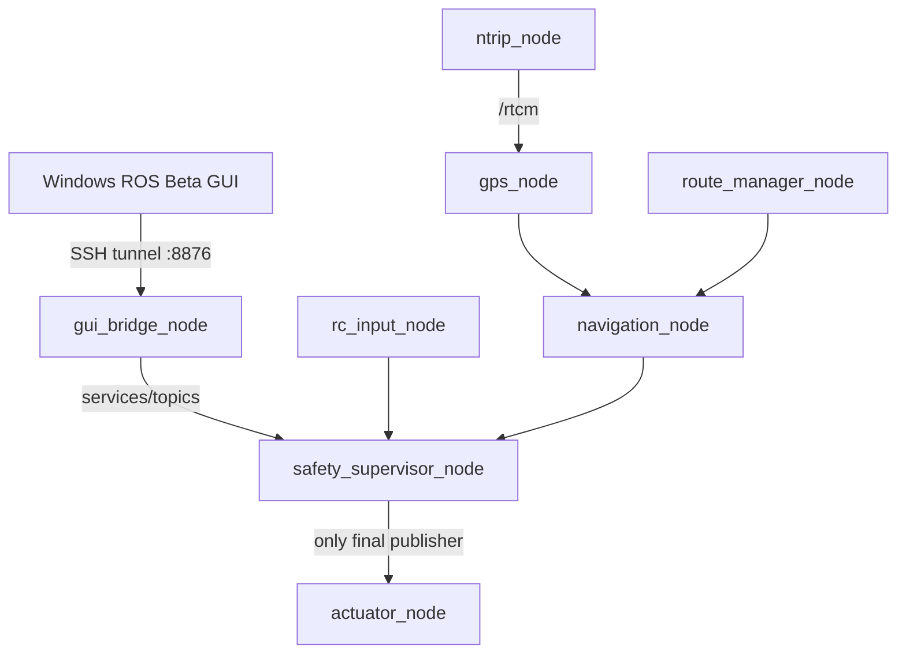

# ROS Beta Architecture

## 실행 구조

ROS master와 bridge는 Jetson loopback에만 묶입니다. Windows가 ROS master 포트를 직접 사용하지 않습니다.

## 하드웨어 단일 owner

| 자원 | 유일 owner | 접근 방식 |
|---|---|---|
| Arduino RC serial | `rc_input_node` | by-id, 9600 baud |
| ZED-F9R GNSS serial | `gps_node` | by-id, 115200 baud, NMEA/UBX + RTCM write |
| `/dev/i2c-1`, PCA9685 0x40 | `actuator_node` | `DirectLinuxPCA9685`, 60 Hz |
| NTRIP network socket | `ntrip_node` | RTCM을 `/rtcm`에 publish |

다른 노드는 serial/I2C를 직접 열지 않습니다.

## 실물과 HIL 프로필

| 구성 | Real | HIL |
|---|---:|---:|
| RC serial | 사용 | 미사용 |
| GNSS serial | 사용 | 미사용 |
| NTRIP | 사용 | 미사용 |
| PCA9685 actuator | 사용 | **노드 없음** |
| mock hardware | 없음 | 사용 |
| GUI bridge | 8876 | 8876 |

## 최종 명령 흐름

MANUAL, REMOTE, NAVIGATION 명령은 PCA로 직접 가지 않습니다. `safety_supervisor_node`가 E-STOP, 하드웨어 상태, RC/REMOTE/NAV timeout과 모드 조건을 평가한 뒤 `/rcboat/safety/actuator_command` 하나만 출력합니다. `actuator_node`는 이 topic만 구독하며 별도로 0.30초 watchdog을 적용합니다.

## 데몬과 상호 배타 제어

세 systemd unit은 `Conflicts=`로 묶이고 전환 스크립트도 다음 순서를 강제합니다.

1. 현재 backend 정지
2. service inactive 확인
3. standalone 6000/6450 적용
4. 목표 backend 시작
5. ROS node/topic/안전 PWM 검사
6. ROS 검사 실패 시 daemon 자동 복귀

기존 `/home/jetson/rcboat`와 `rcboat.service`는 변경하지 않습니다.

## 재사용한 v1.6.0 코드

- `DirectLinuxPCA9685`
- `MixedGpsParser`와 UBX-NAV-PVT 처리
- GPS health 평가
- NTRIP client/GGA/RTCM 처리
- route 기록, 구형 lat/lon route 호환, 보호/삭제
- Multi-Path endpoint 기반 그룹과 전환
- GPS CSV logger
- Windows GUI의 지도, export, 경로, RTK, REMOTE, E-STOP 및 SSH terminal

ROS wrapper, message/service, safety supervisor, GUI bridge, launch/systemd 및 전환 배포 도구는 새로 작성했습니다.
