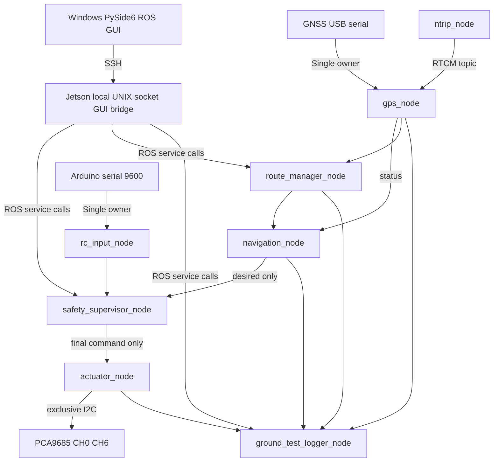

# RC BOAT v2.0.0-beta.2 – 독립 ROS1 설계

## 기준과 보존 범위

기존 GitHub `release/1.6.0` 커밋 `cdee62b6169b8602723b12f0e921c15a54cbba86`은 수정하지 않는다. Jetson 기존 `/home/jetson/rcboat`, `rcboat.service`, Windows `RCBoatControl_v1.6.0.exe`도 변경하지 않는다. 신규 소스는 `/home/jetson/rcboat_ros_ws` 및 로그 `/home/jetson/rcboat_ros_data`에서만 동작한다.

안정판 데이터/설정은 자동 덮어쓰지 않으며, 별도 복사본이 필요한 경우 사용자가 명시적으로 선택한다. `release/1.6.0`에 존재하는 과거 ROS 실험 코드와도 실행 공간을 분리한다.

## 데이터 흐름

ROSMaster와 topics는 Jetson에만 노출한다. Windows는 ROS1을 설치하지 않고 SSH를 통해 Unix-socket 클라이언트를 실행한다. CLI/GUI 두 계층 모두 ROS 제어는 `Execute.srv`를 통해서만 요청한다. 

## GPS/RTK

실물 장비는 초기 인계서에는 ZED-F9R로, 새 요구서에는 ZED-F9P로 적혀 있다. 추정 모델 대신 GNSS가 실제로 출력하는 NMEA+UBX NAV-PVT 필드를 사용한다. GPS USB serial은 `gps_node` 단일 owner이며, `ntrip_node`는 RTCM을 `/rcboat/gps/rtcm`로 발행해 동일 GPS node가 USB 포트에 기록한다. 1개의 serial port를 2개 프로세스에서 열지 않는다.

현재 파서는 GGA/RMC/GSA/GSV 및 UBX NAV-PVT를 수신한다. `hacc_m`은 NAV-PVT의 mm단위 값을 m로 환산한다. Fix 종류는 `RTK_FIXED`, `RTK_FLOAT`, `DGPS`, `NO_RTK`로 구분한다. NTRIP `connected`와 GNSS `rtk_state`는 별도 표시한다. GNSS Course는 저속/정지 시 불안정할 수 있으며 별도의 이중안테나 heading 센서를 사용하는 것으로 가정하지 않는다.

Navigation hard gate: no FIX, stale (2.0s), 좌표 오류, HDOP > 3.0. `C/N0`, `PDOP`, `VDOP`, `hAcc`, 위성 수는 단독으로 stop/go 반복을 만들지 않는다.

## PWM

최신 v1.6.0 GitHub README 실측값을 우선 적용한다.

| 항목 | 16-bit duty value |
| --- | ---: |
| Steering CH0 LOW/CENTER/HIGH | 4900 / 6000 / 7300 |
| ESC CH6 REVERSE/STOP/FORWARD | 5800 / 6450 / 7000 |
| Autonomous cruise | 6650 |
| PWM frequency | 60 Hz |

`DirectLinuxPCA9685` 방식으로 Linux `/dev/i2c-1` 직접 접근한다. adafruit_blinka / Jetson.GPIO 패키지는 사용하지 않는다. **PCA readback은 레지스터 확인일 뿐 물리 서보/모터 피드백이 아니다**.

## Safety / 우선순위

E-STOP, hardware error, command timeout, ground lock, then MANUAL/REMOTE/NAVIGATION/SAFE의 순서로 결정한다. GPS hard fault는 NAVIGATION 추진을 차단하며, 별도 MANUAL 안전 복귀 동작을 허용한다. 최초 베타 설정 `propulsion_allowed=false`는 모든 모드의 실제 구동을 중립으로 유지한다.

독립 2중 차단:

- Supervisor는 GROUND_TEST 중 final_command를 `6000/6450/locked=true`로 발행한다.
- Actuator도 mode==GROUND_TEST, actuator_locked, command timeout, 그리고 별도의 propulsion_allowed=false를 확인한다. 둘 중 하나라도 비정상이면 6000/6450으로 덮어쓴다.

소프트웨어만으로 전원 장애와 PCA 마지막 PWM 유지 위험을 완전히 제거할 수 없다. 실기 지상 검증은 프로펠러 탈거·ESC 추진 전원 물리 차단이 필수다. 향후 무인 주행에는 OE hardware disable / 외부 safety-relay watchdog 추가 검토가 필요하다.

## 전환/복구

- ROS 베타를 `systemctl enable`하지 않는다.
- ROS 진입: daemon 정지 → 프로세스/serial/i2c 해제 검사 → 중립 PWM 작성 및 PCA 레지스터 확인 → ROS 시작.
- 복귀: ROS 정지 → 장치 해제 → 중립 PWM 작성 및 레지스터 확인 → daemon 시작.
- `Conflicts=rcboat.service`를 ROS systemd unit에 선언한다. 오래된 안정판 systemd 파일은 수정하지 않는다.
- 두 프로세스 동시 실행 탐지 시 `CHECK_BACKEND.cmd`는 sudo 승인 후 `--repair`로 두 서비스를 모두 정지하고 소유권 해제를 검사한 뒤 안전 PWM을 기록하고 daemon으로 복귀한다. 소유권이 해제되지 않거나 I2C 검증에 실패하면 오류로 중단하며 실제 하드웨어 안전을 보증하지 않는다.

## 한계(초기 베타)

- ROS Noetic은 EOL이며 실제 ARM64 Jetson에서 종속성 설치/catkin_make를 검증하지 못했다.
- 실제 GPS, Arduino, I2C, NTRIP, 실보트 안전 PWM은 현장 시험 전이다.
- Matlab/QGIS 용 샘플 데이터는 **합성 예시**이며 실제 측정으로 해석하면 안 된다.
- GUI의 map은 좌표 기반 오프라인 경로 뷰로서 원래 외부 바탕지도 레이어와 동등하지 않다.
- 기존 안정판과 모든 GUI 기능 parity가 달성되었다고 주장하지 않는다.
